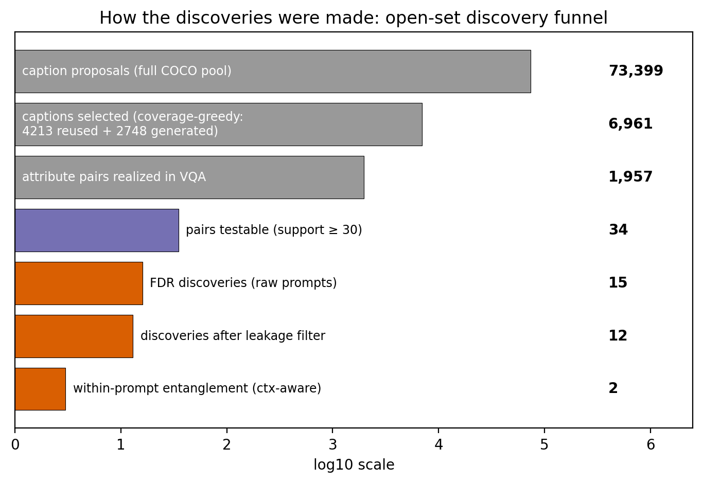
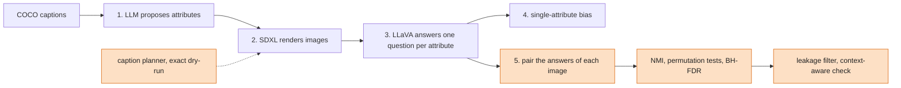
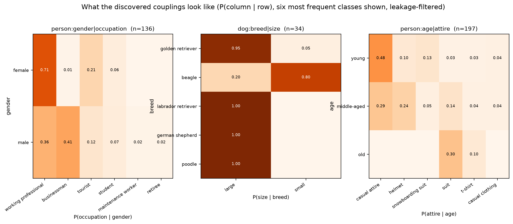
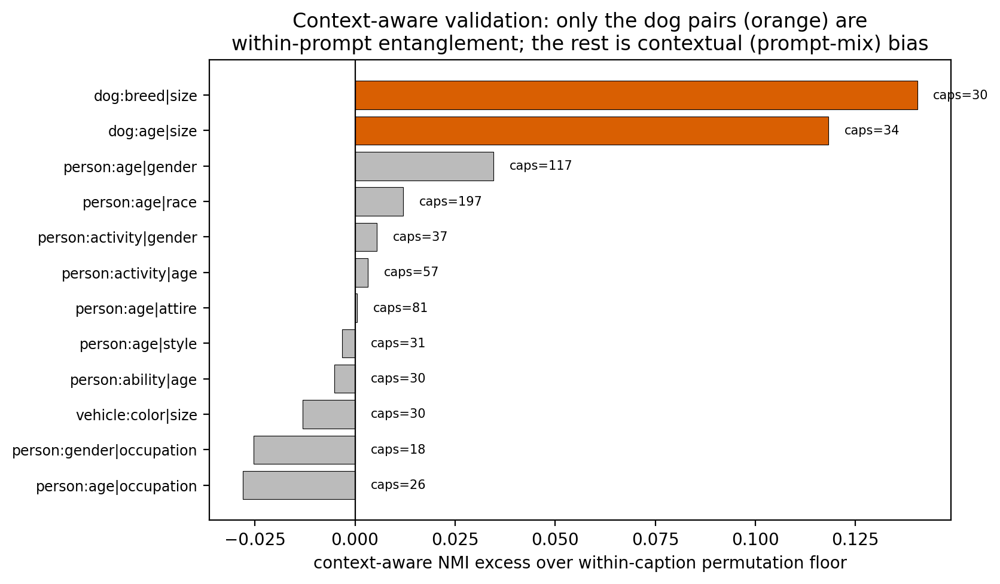
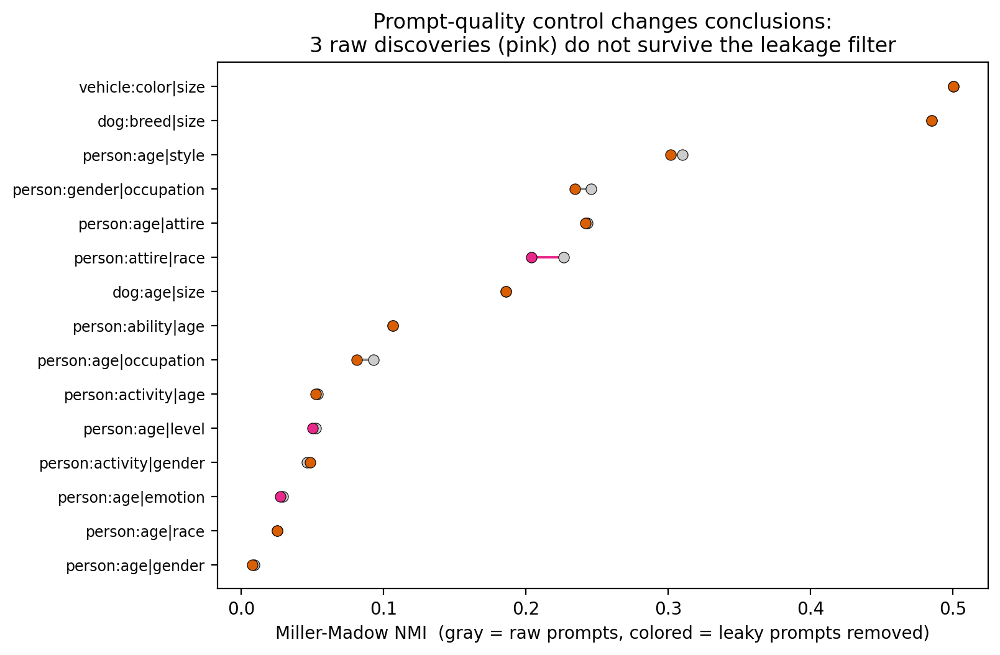

# OpenInterBias

**Open-set discovery of intersectional bias in text-to-image models**

[](https://github.com/giampyhatesyou/OpenInterBias/actions/workflows/tests.yml)
[](#license)

Andrea Giampietro · Irene Verria (equal contribution)

Built on [OpenBias](https://github.com/Picsart-AI-Research/OpenBias) (D'Incà et al., CVPR 2024).
The OpenBias pipeline is used as is, apart from a few changes listed [below](#changes-to-openbias);
its original README is in [docs/OPENBIAS_README.md](docs/OPENBIAS_README.md).

OpenBias measures the bias of a text-to-image model one attribute at a time: an LLM reads a
caption and proposes attributes (a person's age, their attire, ...), the generator renders the
caption and a VQA model labels each image. A model can look balanced on age and on attire
separately and still dress every old person in a suit. OpenInterBias measures that coupling:
it pairs attributes of the same subject, tests whether they depend on each other beyond their
single-attribute biases, and scans every pair the LLM proposes rather than a hand-picked list
such as gender × race.



## Findings (SDXL on COCO captions)

- **12 intersectional couplings** survive Benjamini–Hochberg FDR control (q ≤ 0.05) among the
  34 pairs with enough data, after removing prompts that already state one of the attributes
  (15 before that filter).
- **One of the 12 is an artifact of the label set**: gender × occupation vanishes (NMI 0.23 →
  0.02, permutation p = 0.31) once the gendered label "businessman" is counted as "working
  professional".
- **The demographic pairs usually audited are the weakest couplings found**: age × race (NMI
  0.025) and age × gender (0.008); gender × race is not significant. The strongest couplings lie
  outside the demographic set: for example, the share of people shown in a suit grows with age
  (3 of 107 young, 11 of 80 middle-aged, 3 of 10 old).
- **Within a fixed prompt, only the two dog pairs stay clearly coupled** (breed × size, age ×
  size: +0.14 and +0.12 NMI over a permutation floor, against at most 0.04 for the other pairs).
  The couplings involving people come mostly from pooling prompts with different contexts, not
  from how SDXL renders a single prompt.

## What this adds to OpenBias



Orange: this work. Stages 1–4 are OpenBias.

| | OpenBias | OpenInterBias |
|---|---|---|
| Unit of analysis | one attribute | a pair of attributes of the same subject |
| Score | bias intensity (1 − normalized entropy) | joint intensity on the same scale, plus normalized mutual information (NMI): dependence beyond the two marginals |
| Statistics | point estimates | Miller–Madow correction, bootstrap CIs, permutation tests, BH-FDR over all pairs |
| Prompt control | `present_in_prompt` flag set by the LLM | lexical leakage check against the proposed classes; every result reported with and without leaky prompts |
| Compute | GPU, stages 1–4 | post-hoc stage 5 on cached VQA answers (CPU), plus a planner that picks which captions to render |

## Why pairing OpenBias outputs is not enough

Each part of stage 5 answers a specific way in which naive pairing failed:

| Problem | What we observed | What we did |
|---|---|---|
| Free-text attribute names | 4,554 distinct names in the COCO VQA answers, about 2 captions per pair | reduce each name to its last token ("driver age" → age) and merge reviewed synonyms ([`pairing.py`](intersectional/pairing.py), [`attr_synonyms.json`](intersectional/attr_synonyms.json)) |
| The sampling design starves pairs | the per-bias caption cap applies to both generation and VQA questions: at most 51 joint observations per pair over 6,384 images | an exact CPU dry-run of the questions the pipeline will ask, then a coverage-greedy caption selection that reuses images already rendered: 4,213 of the 6,961 images, about 8 GPU-hours of SDXL ([`dryrun_pairs.py`](intersectional/dryrun_pairs.py), [`openset_select.py`](intersectional/openset_select.py)) |
| Mutual information is biased upward on small samples | plug-in NMI is inflated at n ≈ 10–50 | Miller–Madow correction and bootstrap CIs ([`scoring.py`](intersectional/scoring.py)) |
| Multiple testing | on a first 3,044-image run, age × race looked significant (p ≈ 0.01) and did not survive FDR | permutation tests and Benjamini–Hochberg, with a finer second permutation pass on candidate pairs ([`fdr.py`](intersectional/fdr.py)) |
| Prompts that state the attribute | the LLM's `present_in_prompt` flag misses captions such as "a man in a kitchen" | a leak index built from the proposed class labels; results reported raw and filtered ([`prompt_quality.py`](intersectional/prompt_quality.py)) |
| Dependence created by pooling prompts | a pooled coupling can come from mixing prompts with different contexts | 10 images per caption, compared with a within-caption permutation floor |

## Results

Discoveries after the leakage filter, by effect size (Miller–Madow NMI, all q ≤ 0.05):

| pair | NMI | support |
|---|---:|---:|
| vehicle: color × size | 0.50 | 31 |
| dog: breed × size | 0.48 | 34 |
| person: age × style | 0.30 | 64 |
| person: age × attire | 0.24 | 197 |
| person: gender × occupation | 0.23 | 136 |
| dog: age × size | 0.19 | 64 |
| person: ability × age | 0.11 | 125 |
| person: age × occupation | 0.08 | 283 |
| person: activity × age | 0.05 | 770 |
| person: activity × gender | 0.05 | 376 |
| person: age × race | 0.025 | 1,834 |
| person: age × gender | 0.008 | 2,146 |



*Three discoveries after the leakage filter. Each cell is P(column | row) over all the classes of
the row, and only the six most frequent classes are shown, so rows with many rare classes (old
people in age × attire) sum to less than 1.*

How we read them:

- **Positive controls.** dog breed × size (21 of 22 golden retrievers are large, 4 of 5 beagles
  are small) and dog age × size reflect facts about the world. They are also the only pairs with a
  clear excess over the permutation floor within a fixed prompt (figure below), which shows the
  detector picks up couplings that are really there.
- **A label effect.** In gender × occupation, 57 of 80 women are labeled "working professional"
  and 23 of 56 men "businessman". But "businessman" is a gendered label: counting it as "working
  professional", the NMI drops from 0.23 to 0.02 and the permutation test is no longer
  significant (p = 0.31). This coupling comes from the label set, not from the images.
- **Candidate model biases.** age × attire (suits: 3 of 107 young, 11 of 80 middle-aged, 3 of
  10 old), age × style, activity × gender and age × race. None of them shows a clear excess
  within a fixed prompt: they come from the mix of contexts in the captions.



*Context-aware check: 10 images per caption; the bars show how far the per-caption NMI sits
above a within-caption permutation floor.*

The leakage filter changes the conclusions: three raw discoveries (attire × race, age × emotion,
age × level) do not survive it.



A first closed-set run on gender, race and age only (3,044 images) gave NMI ≤ 0.014 on every
pair and no FDR discovery: SDXL's demographic bias sits mostly in the single attributes (race
is the strongest, with bias intensity ≈ 0.5), not in their combinations.

Full numbers are in [RESULTS.md](RESULTS.md). All six figures are in [docs/figures](docs/figures)
and are drawn by [`make_openset_plots.py`](intersectional/make_openset_plots.py).

## Limitations

- Labels are LLaVA-1.5 predictions, not ground truth. The same model labels both attributes of
  an image, so part of a measured coupling can come from the VQA model (it sees a suit and
  answers "businessman") rather than from the generator.
- The class labels are proposed by the LLM and can encode another attribute ("businessman"
  encodes gender), which creates couplings by construction. We flag these by reading the joint
  tables, as for gender × occupation above; nothing detects them automatically.
- The leakage check matches class labels word by word: it misses inflections and paraphrases,
  so the reported leakage is a lower bound.
- One generator (SDXL), one caption source (COCO) and one VQA model; pairs only, within the same
  subject. Our stage 1–4 baseline uses a reduced budget (2 prompts per bias and 1 image per
  caption, against the upstream 100 and 10).
- The analysis is correlational. Image generation and VQA are not bit-reproducible on GPU, so
  image-dependent numbers can move by a few percent; the CPU statistics are exactly
  reproducible.

## Getting started

The stage-5 unit tests run on CPU with numpy alone:

```bash
pip install numpy pytest
PYTHONHASHSEED=0 python -m pytest tests -q
```

The [v1.0.0 release](https://github.com/giampyhatesyou/OpenInterBias/releases) ships
`openinterbias-v1.0.0-results.zip`: the stage-5 outputs, the LLaVA answers of the open-set runs
and the selected caption IDs. Unzipped in the repository root, it is enough to redraw every
figure on CPU:

```bash
python intersectional/make_openset_plots.py
```

Stage 5 itself also runs on CPU from the cached VQA answers (`results/VQA/...`; the caption
subsets are rebuilt as described in [REPRODUCE.md](REPRODUCE.md#cpu-only-from-the-released-results)),
for example:

```bash
python intersectional/run_analysis.py --dataset coco_openset --generator sd-xl \
    --vqa_model llava-1.5-13b --mode generated --min_support 30 --fdr_q 0.05 \
    --proposed_biases proposed_biases/coco/3/coco_train_openset.json
```

[REPRODUCE.md](REPRODUCE.md) lists every step of the full pipeline, from the environment to the
figures, with the expected output of each command. The GPU stages ran on 1–4 NVIDIA L40S.

```
intersectional/   stage 5: pairing, scoring, FDR, leakage control, caption planner, drivers, figures
tests/            CPU unit tests (35 for stage 5) and checks on the upstream data and config
tools/            pre-flight and inspection helpers
docs/             upstream OpenBias README, figures
*.py, utils/      the OpenBias pipeline (stages 1–4)
```

## Changes to OpenBias

Changes to upstream code are marked in the source with `# CHANGED (fork) - START/END` (JSON
files cannot carry markers, so they are only listed here):

- `utils/utils.py`: fix for an intermittent `KeyError` in `merge_class_clusters` that depended on
  `PYTHONHASHSEED`;
- `utils/synonyms.json`: filled offline for every proposed class (107 → 59,315 entries,
  [`complete_synonyms.py`](intersectional/complete_synonyms.py)), because the ConceptNet API
  queried at run time answered HTTP 502 and stalled GPU jobs;
- `utils/config.py`: paths from environment variables (see `.env.example`), and the reduced
  budget of our baseline run;
- `make_plots.py`: VQA model choices read from the config; `requirements.txt`: a pinned set that
  installs on Python 3.9 with torch 2.5.1.

## Credits

OpenInterBias is joint work by Andrea Giampietro and Irene Verria, who contributed equally. It
started as a university course project on foundation models.

It builds on OpenBias by Moreno D'Incà, Elia Peruzzo, Massimiliano Mancini, Dejia Xu, Vidit
Goel, Xingqian Xu, Zhangyang Wang, Humphrey Shi and Nicu Sebe, and uses Llama 2, Stable
Diffusion XL, LLaVA-1.5 and the COCO captions.

## Citation

If you use this code, please cite both this repository and OpenBias:

```bibtex
@misc{giampietro2026openinterbias,
  author = {Giampietro, Andrea and Verria, Irene},
  title  = {{OpenInterBias}: Open-set Discovery of Intersectional Bias in Text-to-Image Models},
  year   = {2026},
  url    = {https://github.com/giampyhatesyou/OpenInterBias}
}

@InProceedings{D'Inca_2024_CVPR,
  author    = {D'Inc\`a, Moreno and Peruzzo, Elia and Mancini, Massimiliano and Xu, Dejia and Goel, Vidit and Xu, Xingqian and Wang, Zhangyang and Shi, Humphrey and Sebe, Nicu},
  title     = {OpenBias: Open-set Bias Detection in Text-to-Image Generative Models},
  booktitle = {Proceedings of the IEEE/CVF Conference on Computer Vision and Pattern Recognition (CVPR)},
  month     = {June},
  year      = {2024},
  pages     = {12225-12235}
}
```

## License

The code and documentation written for OpenInterBias are released under the [MIT license](LICENSE).
The OpenBias code, which had no license upstream, and the bundled LLaVA, StyleGAN3 and Llama 2
code keep their own terms: see [THIRD_PARTY_NOTICES.md](THIRD_PARTY_NOTICES.md).
